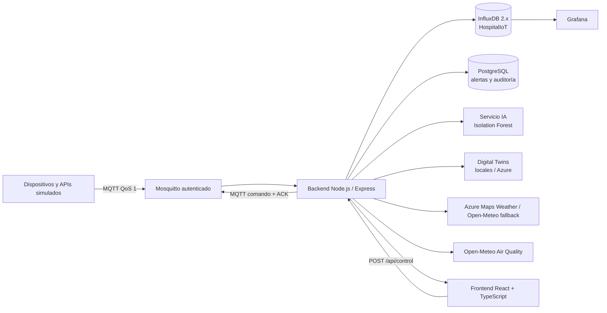

# Hospital Inteligente IoT

Plataforma académica para monitoreo de telemetría hospitalaria, activos simulados, condiciones ambientales y recursos críticos. Incluye simuladores MQTT, API REST, histórico de seis días a intervalos de cinco minutos, dashboards Grafana, analítica estadística y detección de anomalías con Isolation Forest.

> **Uso académico únicamente.** Todos los datos de paciente son sintéticos. Esta aplicación no es un dispositivo médico, no está validada para uso clínico y no debe usarse para diagnóstico, tratamiento ni operación de equipamiento real.

## Arquitectura



La descripción académica extendida, tablas, protocolos, diagramas, reglas, supuestos y referencias IEEE está en [docs/PROYECTO.md](./docs/PROYECTO.md). Los pasos de nube están en [infra/azure/README.md](./infra/azure/README.md).

## Requisitos

- Docker Engine y Docker Compose v2.
- Git.
- Opcionales: Node.js 20+ (desarrollo local fuera de Docker), Python 3.12 (analítica), Azure CLI y Bicep (despliegue).

## Inicio rápido local

```bash
cp .env.example .env
# Cambia todas las contraseñas de desarrollo; conserva usuario y contraseña MQTT iguales para broker y clientes.
docker compose up --build
```

La carga inicial escribe **1.728 muestras por serie** (6 días × 24 horas × 12 muestras/hora) en `HospitalIoT`. Cada servicio espera sus dependencias saludables. URLs locales:

| Servicio | URL |
|---|---|
| Aplicación React | http://localhost:5173 |
| Backend REST | http://localhost:3000/api |
| Swagger UI | http://localhost:3000/docs |
| Grafana | http://localhost:3001 |
| InfluxDB | http://localhost:8086 |
| MQTT TCP | `localhost:1883` |
| OpenAPI | [backend/openapi.json](./backend/openapi.json) |

Grafana usa `GRAFANA_USER` y `GRAFANA_PASSWORD` del `.env`. El token API de Influx es `INFLUX_TOKEN`. Se recomienda abrir Grafana en una ventana separada.

### Parar y reiniciar

```bash
docker compose down
# Para borrar permanentemente las bases de datos locales:
# docker compose down -v
```

`docker compose down -v` elimina el histórico, alertas, contraseñas MQTT generadas y estado de Grafana; no lo uses si deseas conservar datos. La siembra genera nuevamente el período histórico al iniciar Compose.

## Dispositivos, APIs y telemetría

El catálogo de diez fuentes está definido en [backend/src/devices.js](./backend/src/devices.js). Nueve fuentes publican snapshots MQTT; `historical-dataset` se siembra directamente en InfluxDB.

| ID | Fuente | Variables principales |
|---|---|---|
| `patient-icu01`, `patient-icu02` | Monitores UCI | `heartRate`, `oxygen`, `bodyTemperature` |
| `fridge01` | Refrigerador de vacunas | `temperature`, `doorOpen`, `voltage` |
| `room01` | Sala de cirugía | `temperature`, `humidity`, `airQuality`, `co2` |
| `twin-or01` | Gemelo quirófano | `temperature`, `humidity`, `occupancy` |
| `twin-icu` | Gemelo UCI | `availableBeds`, `connectedPatients`, `operationalEquipment` |
| `twin-pharmacy` | Gemelo farmacia | `inventory`, `criticalMedicationCount`, `temperature` |
| `weather-external` | Azure Maps Weather | `temperature`, `humidity`, `rainProbability` |
| `airquality-external` | Open-Meteo Air Quality | `aqi`, `pm25`, `pm10` |
| `historical-dataset` | Dataset de seis días | `energyKwh`, `occupancy`, `temperature` |

Weather Atlas se habilita con una clave **Azure Maps** en `AZURE_MAPS_KEY`. Sin clave, `GET /api/weather` y el simulador usan condiciones reales de Open-Meteo, identificadas por proveedor; la calidad del aire también consulta Open-Meteo. Ambos requieren acceso de red. Coordenadas configurables: `HOSPITAL_LATITUDE` y `HOSPITAL_LONGITUDE`.

Ejemplo MQTT real del simulador (payload plano):

```json
{
  "deviceId": "patient-icu01",
  "heartRate": 87,
  "oxygen": 98,
  "bodyTemperature": 36.8,
  "timestamp": "2026-10-10T15:00:00Z",
  "source": "simulated"
}
```

Se admiten también mensajes con los valores agrupados en un objeto `metrics`. El broker requiere nombre de usuario y contraseña, usa QoS 1 para telemetría/ACK y retiene snapshots de telemetría. Los comandos no son retained. Topics y contrato están documentados en [docs/PROYECTO.md](./docs/PROYECTO.md#11-protocolos-y-topics-mqtt).

## API REST

Todas las rutas, salvo `/docs`, tienen prefijo `/api`:

| Método | Endpoint | Descripción |
|---|---|---|
| `GET` | `/health` | Estado del backend |
| `GET` | `/devices` | Diez dispositivos, estado online/offline y última muestra |
| `GET` | `/devices/:id` | Detalle de un dispositivo |
| `GET` | `/metrics?deviceId=patient-icu01&metric=heartRate&range=24h` | Serie agregada cada cinco minutos |
| `GET` | `/alerts?limit=50` | Alertas activas y resueltas |
| `GET` | `/analytics` | Tendencias, extremos y predicciones/anomalías no supervisadas |
| `POST` | `/control` | Comando MQTT auditado |
| `GET` | `/twins` | Snapshots de los gemelos locales |
| `GET` | `/weather` | Azure Maps o condiciones reales de Open-Meteo si no hay clave |

`range` acepta `1h`, `6h`, `24h` o `7d`. Swagger: http://localhost:3000/docs.

### Control remoto

En local, el token de control puede dejarse vacío en `.env`; el servidor exige token si `CONTROL_TOKEN` tiene valor. En Azure es obligatorio definir uno, y el panel permite ingresarlo en memoria de sesión del navegador. Ejemplo:

```bash
curl -X POST http://localhost:3000/api/control \
  -H 'Content-Type: application/json' \
  -d '{"deviceId":"fridge01","command":"calibrate"}'
```

Para instalaciones con token añade `-H 'Authorization: Bearer <CONTROL_TOKEN>'`. Comandos: `turn_on`, `turn_off`, `restart`, `calibrate`, `set_interval` y `simulate_failure`. Para cambiar frecuencia: `{"deviceId":"room01","command":"set_interval","parameters":{"intervalMs":300000}}`. Solo se aceptan intervalos de 5.000 a 3.600.000 ms. Los registros de auditoría se conservan en PostgreSQL.

## Reglas y analítica

- Frecuencia cardíaca `>140 bpm`; saturación `<90%`; refrigerador `>8 °C`; CO₂ `>1000 ppm`; humedad `<40%`.
- Las transiciones de alerta y recuperación se guardan en PostgreSQL; el panel incluye últimos eventos.
- `analytics-ai` utiliza Isolation Forest no supervisado de scikit-learn sobre muestras agregadas de InfluxDB. La API complementa con promedio, mínimo, máximo, tendencia y conteo de valores atípicos.
- Los umbrales son ilustrativos y configurables en [backend/src/alerts.js](./backend/src/alerts.js); **no son criterios clínicos**.

## Desarrollo y pruebas

```bash
cd backend
npm install
npm test
```

```bash
cd frontend
npm install
npm run build
```

El backend aislado necesita variables `INFLUX_TOKEN` y `DATABASE_URL`; para validar el proyecto completo, usa Docker Compose. CI está en [.github/workflows/ci.yml](./.github/workflows/ci.yml).

## Despliegue Azure

Los templates de [infra/azure/](./infra/azure/) preparan Azure Container Apps, PostgreSQL Flexible Server con red privada, Azure Files, Log Analytics/Monitor, ACR, Digital Twins y App Service. Azure Maps requiere una clave; Azure DNS personalizado requiere un dominio propio. Sin esos datos, Weather usa Open-Meteo y los servicios web usan FQDN públicos de Azure.

Para DNS personalizado, proporciona un dominio propio y delega los nameservers entregados por Azure DNS; habilita HTTPS y valida el certificado antes de compartir el dominio. La URL por defecto de Container Apps será un FQDN público `azurecontainerapps.io`.

Revisa el presupuesto antes de desplegar; PostgreSQL, Container Apps, almacenamiento y Log Analytics pueden generar costos. El template utiliza tamaños académicos de baja escala, no un sizing de producción hospitalaria.

## Publicación en GitHub

El remoto configurado es `https://github.com/SofiOyola/Hospital-Inteligente-IoT.git`. Para publicar después de revisar los archivos y evitar secretos:

```bash
git add .
git status
git commit -m "Build Hospital IoT monitoring platform"
git push -u origin main
```

No agregues `.env`, credenciales Azure, tokens ni datos reales. El `.gitignore` excluye `.env` y artefactos generados.

## Documento académico y PDF

- Documento universitario completo, con los veinte capítulos solicitados y cinco diagramas Mermaid: [docs/PROYECTO.md](./docs/PROYECTO.md).
- Muestra CSV y calendario de eventos: [datasets/](./datasets/).
- Convertir a PDF: instala Pandoc, XeLaTeX y `mermaid-filter`, luego ejecuta `./scripts/generate-pdf.sh`. La conversión es local; no se suben documentos a terceros.
