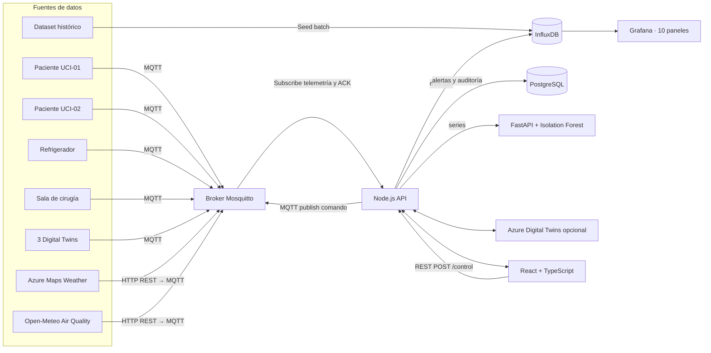
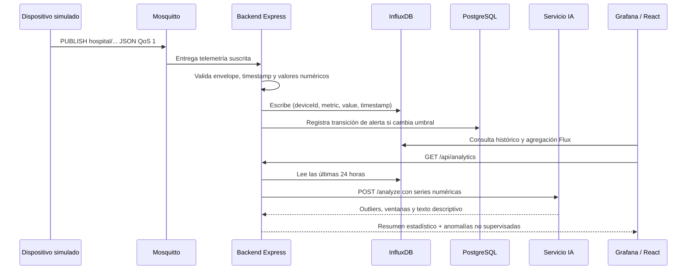

# Hospital Inteligente IoT - Plataforma de Monitoreo Hospitalario y Control Clínico

**Documento académico para sustentación**  
**Versión:** 1.0 · **Fecha:** noviembre de 2026  
**Proyecto:** Hospital Inteligente IoT  
**Autoría:** Equipo académico  
**Clasificación:** Simulación educativa; no es un sistema clínico certificado.

> **Aviso de seguridad clínica:** los sensores, pacientes, alertas, históricos y acciones remotas de este proyecto son simulados. No conecte dispositivos médicos reales ni use las métricas para diagnosticar, tratar pacientes o decidir intervenciones.

## 1. Resumen

El proyecto implementa una plataforma IoT académica para integrar telemetría simulada de dos monitores de paciente UCI, refrigeración de vacunas y ambiente de quirófano; tres gemelos digitales; dos proveedores meteorológicos/ambientales; y un dataset hospitalario histórico. Mosquitto transporta telemetría y comandos, una API Node.js/Express valida y procesa los mensajes, InfluxDB conserva series temporales y PostgreSQL persiste alertas y auditoría. React/TypeScript presenta el centro de operaciones y Grafana ofrece paneles históricos. Un servicio Python ejecuta Isolation Forest para identificar valores atípicos y un módulo estadístico calcula promedios, extremos y tendencias.

Docker Compose permite ejecutar localmente el sistema completo, incluido un seed de seis días con 1.728 marcas temporales por serie a intervalos de cinco minutos. La infraestructura Bicep prepara Azure Container Apps, Azure Database for PostgreSQL, ACR, Azure Storage, Azure Monitor y opciones de Azure Digital Twins, App Service y DNS. El despliegue público requiere credenciales y recursos de Azure del propietario.

## 2. Introducción

Un hospital inteligente coordina procesos clínicos, equipos, infraestructura y servicios digitales mediante datos oportunos y verificables. IoT permite recolectar telemetría en distintas zonas; los protocolos de mensajería desacoplan dispositivos del procesamiento; las bases de datos especializadas conservan señales de diversa naturaleza; y la analítica ayuda a priorizar observaciones.

Este prototipo modela tales componentes con dispositivos de software, APIs externas y datos generados, evitando datos personales o conectividad a dispositivos médicos. Se priorizan trazabilidad, modularidad, reproducibilidad y controles explícitos.

## 3. Descripción del Hospital Inteligente

El escenario contiene:

- **Atención:** dos camas UCI virtuales con frecuencia cardíaca, saturación y temperatura corporal sintéticas.
- **Cadena de frío:** refrigerador de vacunas con temperatura, puerta y voltaje.
- **Infraestructura:** sala de cirugía con temperatura, humedad, partículas/índice ambiental y CO₂.
- **Gemelos digitales:** quirófano, UCI y farmacia, actualizados por snapshots.
- **Contexto externo:** Azure Maps Weather (clima) y Open-Meteo (calidad de aire).
- **Histórico operativo:** consumo energético, ocupación y temperatura durante seis días.

La plataforma no modela identidades de pacientes, historias clínicas, medicamentos a nivel de paciente ni decisiones terapéuticas.

## 4. Problema abordado

En un entorno hospitalario distribuido, los datos pueden quedar aislados en equipos y áreas, dificultando observar cambios, verificar recursos y conservar históricos. La falta de un canal bidireccional controlado limita simular mantenimiento y operación remota. También es difícil probar dashboards, alertas e integración cloud sin datasets consistentes.

El prototipo ofrece una ruta demostrable extremo a extremo desde la publicación de telemetría hasta la visualización histórica y el envío de comandos, con incidentes sintéticos reproducibles. No pretende resolver interoperabilidad certificada, privacidad clínica, disponibilidad hospitalaria ni seguridad funcional de equipos.

## 5. Objetivos

### Objetivo general

Diseñar e implementar una plataforma académica de monitoreo IoT hospitalario que integre simuladores, MQTT, APIs REST, gemelos digitales, bases de datos históricas, visualización, alertas, analítica no supervisada y una ruta de despliegue Azure.

### Objetivos específicos

1. Modelar al menos diez fuentes de datos hospitalarias y documentar sus variables y unidades.
2. Procesar telemetría con MQTT y REST con contratos verificables.
3. Persistir series temporales y eventos operacionales en almacenes adecuados.
4. Construir un dashboard React y diez paneles Grafana con filtros temporales.
5. Simular control remoto con autorización configurable, ACK y auditoría.
6. Generar seis días de datos en muestras de cinco minutos con eventos de operación.
7. Explorar tendencias y anomalías mediante estadísticas e Isolation Forest.
8. Describir infraestructura desplegable en Azure y sus límites de seguridad/costo.

## 6. Arquitectura IoT de referencia

La solución separa el plano de telemetría del plano de control:

- **Telemetría:** simuladores/API → MQTT QoS 1 → backend → InfluxDB → Grafana y analítica.
- **Control:** interfaz → REST validado/token opcional en local y obligatorio en nube → auditoría PostgreSQL → comando MQTT QoS 1 → simulador → ACK.
- **Contexto:** las APIs Weather Atlas y Open-Meteo son consultadas desde el simulador; los snapshots se publican en topics dedicados.
- **Gemelos digitales:** los tres gemelos funcionan localmente como estado lógico y se pueden sincronizar con Azure Digital Twins cuando la instancia, modelos y managed identity están habilitados.
- **Persistencia:** InfluxDB conserva métricas; PostgreSQL conserva alertas y auditoría de comandos.

### Componentes y responsabilidades

| Componente | Tecnología | Responsabilidad |
|---|---|---|
| Simulador IoT | Node.js + MQTT.js | Generar dispositivos, eventos, APIs y escuchar comandos |
| Broker | Eclipse Mosquitto | Enrutar publicaciones/suscripciones autenticadas |
| API | Node.js, Express | REST, validación, OpenAPI, alertas y gemelos |
| Base temporal | InfluxDB 2.x | Métricas con tags y timestamps |
| Base relacional | PostgreSQL 16 | Alertas, estados y auditoría |
| Servicio IA | Python, FastAPI, scikit-learn | Isolation Forest sobre series numéricas |
| Web | React, TypeScript, Recharts | Estado, series, gemelos y canal de control |
| Observabilidad | Grafana | Consultas Flux y dashboards |
| Azure | Container Apps, Flexible Server, Storage, Monitor | Hosting cloud de servicios y persistencia |

## 7. Diagrama general



## 8. Diagrama de flujo de datos



## 9. Sensores y variables

Los rangos que producen los simuladores son rangos educativos, no especificaciones de sensores ni límites clínicos.

| Variable | Unidad/tipo | Dispositivo | Rango/modelo sintético |
|---|---|---|---|
| Frecuencia cardíaca | bpm | UCI-01/02 | Dentro del dominio pedido 40–180; normal variable y evento de aumento |
| Saturación | % | UCI-01/02 | Dentro del dominio pedido 80–100 |
| Temperatura corporal | °C | UCI-01/02 | Dominio sintético 34–42; valores habituales simulados ~36–37.5 |
| Temperatura de refrigeración | °C | `fridge01` | Dentro del dominio pedido −10 a 15; incidente supera 8 |
| Puerta | 0/1 | `fridge01` | 1 abierta, 0 cerrada |
| Voltaje | V | `fridge01` | 0 durante corte, ~218–230 nominal simulado |
| Temperatura ambiente | °C | Quirófano/gemelos | 19–25 °C simulados |
| Humedad | %RH | Quirófano/gemelo | 40–60% en normal; se admiten condiciones anómalas |
| Calidad ambiental | índice arbitrario | `room01` | Partículas/índice ambiental no clínico |
| CO₂ | ppm | `room01` | ~420–1.100 ppm con picos de ocupación |
| Ocupación | 0/1 o razón 0–1 | Twin/dataset | Binaria para quirófano; razón en dataset hospitalario |
| Camas/pacientes/equipos | conteos | Twin UCI | Enteros simulados |
| Inventario/medicamentos críticos | unidades | Twin Farmacia | Conteos simulados |
| Temperatura exterior, humedad, lluvia | °C, %, % | Weather Atlas | REST real si se configura clave; simulada si no |
| AQI, PM2.5, PM10 | AQI, µg/m³ | Open-Meteo | REST actual si disponible |
| Energía | kWh por muestra/intervalo | Dataset | Patrón diario sintético |

## 10. Tabla de dispositivos y fuentes

| # | ID | Fuente | Variables | Transporte |
|---:|---|---|---|---|
| 1 | `patient-icu01` | Monitor UCI 01 | `heartRate`, `oxygen`, `bodyTemperature` | MQTT |
| 2 | `patient-icu02` | Monitor UCI 02 | `heartRate`, `oxygen`, `bodyTemperature` | MQTT |
| 3 | `fridge01` | Refrigerador de vacunas | `temperature`, `doorOpen`, `voltage` | MQTT |
| 4 | `room01` | Sensores quirófano | `temperature`, `humidity`, `airQuality`, `co2` | MQTT |
| 5 | `twin-or01` | Gemelo Quirófano 1 | `temperature`, `humidity`, `occupancy` | MQTT / Azure Digital Twins opcional |
| 6 | `twin-icu` | Gemelo UCI | `availableBeds`, `connectedPatients`, `operationalEquipment` | MQTT / Azure Digital Twins opcional |
| 7 | `twin-pharmacy` | Gemelo Farmacia | `inventory`, `criticalMedicationCount`, `temperature` | MQTT / Azure Digital Twins opcional |
| 8 | `weather-external` | Azure Maps Weather | `temperature`, `humidity`, `rainProbability` | HTTP → MQTT |
| 9 | `airquality-external` | Open-Meteo | `aqi`, `pm25`, `pm10` | HTTP → MQTT |
| 10 | `historical-dataset` | Generador histórico | `energyKwh`, `occupancy`, `temperature` | Escritura batch InfluxDB |

## 11. Protocolos y topics MQTT

### MQTT

MQTT es un protocolo de mensajería publish/subscribe sobre TCP. El productor no necesita conocer a cada consumidor: publica a un topic; el broker valida credenciales y reenvía a los clientes suscritos.

| Topic | Productor | Contenido |
|---|---|---|
| `hospital/patient/icu01` | UCI-01 | HR, oxígeno y temperatura corporal |
| `hospital/patient/icu02` | UCI-02 | HR, oxígeno y temperatura corporal |
| `hospital/pharmacy/fridge01` | Refrigerador | temperatura, puerta y voltaje |
| `hospital/operatingroom/room01` | Sensores quirófano | temperatura, humedad, índice y CO₂ |
| `hospital/twins/operating-room-01` | Simulador twin | temperatura, humedad, ocupación |
| `hospital/twins/icu` | Simulador twin | camas, pacientes, equipos |
| `hospital/twins/pharmacy` | Simulador twin | inventario y farmacia |
| `hospital/external/weather` | Adaptador Azure Maps | clima exterior |
| `hospital/external/airquality` | Adaptador Open-Meteo | AQI, PM2.5, PM10 |
| `hospital/control/{deviceId}` | API backend | comando remoto; no retained |
| `hospital/command/{deviceId}/ack` | Dispositivo simulado | confirmación de comando |

**Payload compatible con el contrato plano requerido:**

```json
{
  "deviceId": "patient-icu01",
  "heartRate": 87,
  "oxygen": 98,
  "bodyTemperature": 36.8,
  "timestamp": "2026-10-10T15:00:00Z",
  "source": "simulated"
}
```

El consumidor también acepta `{ "deviceId": "...", "timestamp": "...", "metrics": { "heartRate": 87 } }`. Los valores almacenables deben ser numéricos y finitos.

### Publish, Subscribe, QoS y retained

- **Publish:** productor envía JSON a un topic, con QoS y opción retained.
- **Subscribe:** backend escucha `hospital/+/+` (telemetría) y `hospital/command/+/ack`; simulador escucha `hospital/control/+`.
- **QoS 0:** como máximo una entrega, sin ACK.
- **QoS 1:** al menos una entrega; puede duplicar mensajes. El backend usa escritura idempotente por tags y timestamp de Influx. Se prioriza la entrega de comandos/telemetría frente a evitar cada duplicado.
- **QoS 2:** exactamente una entrega con mayor costo de protocolo; no se necesita para esta simulación.
- **Retained:** el broker conserva el último snapshot de telemetría para un nuevo subscriber. Los comandos llevan `retain=false` para impedir ejecutar órdenes antiguas al reconectar.

En Docker de desarrollo, el broker está expuesto en `localhost:1883` con usuario y contraseña del `.env`. En Azure, MQTT solo escucha dentro del entorno Container Apps. Producción hospitalaria requeriría TLS, rotación de identidades/credenciales, ACL por topic y certificados por dispositivo.

### HTTP REST

REST/JSON se usa para consultar catálogo, series, alertas, analítica, twins y clima; y para emitir un comando remoto. Los GET son idempotentes. `POST /control` valida entradas, escribe auditoría y publica al topic específico. Una confirmación tardía produce respuesta `202 Accepted` con resultado `accepted`; una respuesta de simulador antes del timeout incluye ACK `success`.

## 12. API, validación y códigos HTTP

El contrato OpenAPI se encuentra en [backend/openapi.json](../backend/openapi.json) y la interfaz interactiva se sirve en `/docs`.

| Endpoint | Respuesta esperada |
|---|---|
| `GET /api/devices` | `200`, diez elementos con `status`, `lastSeen` y última telemetría |
| `GET /api/devices/:id` | `200` o `404` |
| `GET /api/metrics` | `200`; rango permitido `1h`, `6h`, `24h`, `7d`; dispositivo del catálogo |
| `GET /api/alerts` | `200`, hasta 500 eventos |
| `GET /api/analytics` | `200`; `503` si el servicio IA no está accesible |
| `POST /api/control` | `202`, `400` entrada inválida, `401` token incorrecto, `500` broker no conectado |
| `GET /api/twins` | `200`, snapshots disponibles desde la primera telemetría |
| `GET /api/weather` | `200` real; `503` si falta AZURE_MAPS_KEY; `500` si el proveedor falla |

El backend valida catálogo de dispositivos, sintaxis de métricas, comandos permitidos y límites de frecuencia de publicación. La carga útil JSON tiene límite de 32 KB. El token de control usa comparación en tiempo constante. Para producción, reemplazar el token compartido por identidad Entra ID y autorización por rol.

## 13. Azure y servicios cloud

`infra/azure/main.bicep` describe:

- **Azure Container Apps:** API, frontend, Mosquitto, InfluxDB, Grafana y analítica IA. UI/API y Grafana se exponen mediante HTTPS de ACA; broker, Influx y IA son privados dentro del entorno.
- **Azure Database for PostgreSQL Flexible Server:** red privada delegada, base `hospital_iot` para alertas y auditoría.
- **Azure Storage:** Azure Files para persistencia de InfluxDB/Grafana; blobs no son públicos.
- **Azure Monitor:** Log Analytics para consola de Container Apps, retención de 30 días en plantilla.
- **Azure Container Registry:** registry sin cuenta admin; managed identity con rol AcrPull.
- **Azure Digital Twins:** opcional, con modelos DTDL del proyecto y rol de datos para managed identity.
- **Azure Maps Weather:** clave opcional guardada como secreto en Container Apps.
- **Azure DNS:** zona opcional si el operador posee un dominio y especifica `dnsZoneName`; el template no cambia la delegación del registrar ni crea un certificado de dominio propio.
- **Azure App Service:** despliegue opcional del frontend para requerimientos académicos/híbridos; Azure Container Apps es el camino principal.

No se ejecutó el despliegue: la suscripción, cuota, permisos de red, región y secretos deben ser aportados por el propietario. Antes de ejecutar, validar precio/capacidad, dominio y políticas de acceso. La configuración de red privada de PostgreSQL evita abrir el puerto al público. InfluxDB, broker y servicio IA no tienen ingress externo en ACA.

## 14. Grafana y dashboards

Grafana se configura automáticamente con el datasource Flux `Hospital InfluxDB` y el dashboard `Hospital Inteligente IoT` (UID `hospital-iot-overview`). El filtro temporal predeterminado cubre seis días; variable de dashboard permite filtrar por ID de dispositivo donde aplica.

Diez paneles:

1. Frecuencia cardíaca.
2. Saturación de oxígeno.
3. Temperatura corporal.
4. Temperatura refrigerador.
5. Temperatura quirófano.
6. Humedad.
7. CO₂.
8. Ocupación.
9. Consumo energético.
10. Eventos de alertas.

Las series se agregan en ventanas con media para reducir densidad; el panel energético y de alarmas usa agregación `mean`/`max` apropiada. La API `/analytics` calcula media, mínimo y máximo sobre el rango de 24 horas. Los paneles y variables se encuentran en `grafana/dashboards/hospital-overview.json`.

## 15. Análisis y almacenamiento de datos

### InfluxDB

- Organización: `hospital`.
- Bucket: `HospitalIoT`.
- Measurement: `telemetry`.
- Tags: `deviceId`, `metric`.
- Field: `value` como float.
- Timestamp: UTC en milisegundos.
- Lectura: Flux con filtros de catálogo/rango y agregación de cinco minutos.

El seed genera seis días exactos, 1.728 timestamps por serie, con muestreo cada cinco minutos. Los datos se escriben como series independientes para dispositivo/variable. Las alertas operativas y de auditoría se mantienen relacionales en PostgreSQL; un campo `alert` de Influx alimenta la visualización temporal. Cinco incidentes históricos sintéticos se registran también como eventos resueltos, sin aparecer como alarmas activas. La carga de puntos y de eventos históricos es idempotente.

### PostgreSQL

- `alerts`: severidad, dispositivo, variable, valor, estado, primer/último momento y resolución.
- `alerts.source`: distingue alertas `live` de eventos sintéticos `historical`.
- `command_audit`: ID, dispositivo, comando, fecha y respuesta JSON.
- Inicialización idempotente con `CREATE TABLE IF NOT EXISTS` al iniciar API y al ejecutar el seed.

## 16. Analítica con IA

La API agrupa valores recientes por dispositivo/variable, consulta el servicio FastAPI y recibe un reporte Isolation Forest. El modelo no supervisado detecta observaciones aisladas sin etiquetas; para cada serie numérica con al menos 12 puntos ajusta 100 árboles con contaminación estimada del 3%. Se informa cantidad y ventana temporal de outliers, y se agregan resúmenes estadísticos: promedio, mínimo, máximo, diferencia de tendencia entre mitades y posibles picos.

Los ejemplos de lenguaje son generados a partir de mediciones y ventanas encontradas, no por una inferencia médica. Se debe validar calibración de sensores, variabilidad normal, estacionalidad y falsos positivos antes de interpretar una anomalía. Las reglas son explicables y se complementan con Isolation Forest; no se entrenó un modelo clínico ni se usaron datos de pacientes.

Ejemplo de resumen: “Isolation Forest detectó posibles valores atípicos de temperatura en fridge01 durante la ventana observada; revisar el sensor y el evento simulado de cadena de frío.”

## 17. Alertas y reglas

| Métrica | Regla | Severidad | Respuesta |
|---|---:|---|---|
| `heartRate` | `>140` | Critical | Guardar alerta y publicar evento |
| `oxygen` | `<90` | Critical | Guardar alerta y publicar evento |
| Temperatura de `fridge01` | `>8 °C` | Critical | Alertar posible excursión de frío |
| `co2` | `>1000 ppm` | Warning | Alertar ventilación/ocupación simulada |
| `humidity` | `<40%` | Warning | Alertar condición ambiental |
| `sensorFailure` | `>0` | Warning | Reportar falla simulada |

Cada transición normal→alerta crea un registro; el retorno al rango actualiza el evento a `resolved`. El frontend muestra eventos recientes y el dashboard Grafana muestra transiciones temporales. Si el servicio se reinicia mientras una alerta permanece activa, se reevalúa con nuevos datos, pero el estado activo local en memoria se reinicializa; despliegues operacionales deberían persistir el estado de cada regla y reconstruirlo desde PostgreSQL.

## 18. Control bidireccional

La UI permite elegir el dispositivo y emitir `turn_on`, `turn_off`, `restart`, `calibrate`, `set_interval` o `simulate_failure`. El API verifica el ID/acción, intervalo, token configurado y persiste auditoría antes de publicar `hospital/control/{deviceId}` con QoS 1 y `retain=false`. El simulador recibe el JSON, aplica un cambio a su estado virtual y responde por `hospital/command/{deviceId}/ack`.

Ejemplo:

```json
{
  "deviceId": "fridge01",
  "command": "calibrate",
  "parameters": {},
  "timestamp": "2026-10-10T15:00:00Z"
}
```

ACK:

```json
{
  "deviceId": "fridge01",
  "command": "calibrate",
  "status": "success",
  "timestamp": "2026-10-10T15:00:01Z"
}
```

Las acciones solo afectan el simulador. Los comandos nunca se marcan retained. Una respuesta fuera del límite de cinco segundos se representa como comando publicado sin confirmación y no como éxito confirmado.

## 19. Datos históricos y resultados

El generador produce patrones diarios con ruido controlado y cinco escenarios:

| Escenario | Simulación | Señal observada |
|---|---|---|
| Corte eléctrico | Día 3, 30 min, `voltage=0` | Excursión de temperatura del refrigerador |
| Aumento ocupacional | Día 2, varias horas | Ocupación, CO₂ y medidas sintéticas UCI |
| Ola de calor | Día 4 | Temperatura exterior/quirófano más alta |
| Falla de sensor | Día 6, seis muestras omitidas de UCI-02 | Hueco temporal en serie |
| Mantenimiento | Día 5, una hora | Indicador de puerta abierto durante la ventana |

La carga inicial puede verificarse en Grafana seleccionando “Last 6 days”. Ejemplos tabulares de incidentes están en `datasets/eventos-ejemplo.csv`; la fuente de verdad completa se genera al iniciar `history-seed` y se conserva en volumen local o Azure Files.

Los criterios de aceptación demostrables son: diez fuentes en catálogo; cinco protocolos/servicios (MQTT, HTTP REST, Influx Flux, PostgreSQL y endpoints de proveedor); seis días de histórico a 5 min; paneles provisionados; reglas de umbral; dos canales de control (REST/MQTT); endpoints OpenAPI; y build de frontend/tests de validación.

## 20. Conclusiones y referencias IEEE

### Conclusiones

1. La separación MQTT/REST/series temporales/relacional permite desacoplar fuentes y consumidores y presentar trazabilidad de extremo a extremo.
2. El histórico sintético controlado facilita pruebas reproducibles de consulta, alertas y análisis.
3. Los gemelos digitales y APIs externas enriquecen el contexto, pero requieren contratos, autenticación e integración de identidad para producción.
4. Isolation Forest añade una técnica de detección no supervisada; sus resultados son observaciones estadísticas, no conclusiones clínicas.
5. Azure permite desplegar componentes administrados, pero la seguridad requiere secretos, red privada para datos, HTTPS, identidad gestionada, control de acceso, presupuesto y revisión de región.
6. La plataforma no es un dispositivo médico ni está certificada para operar en un hospital real.

### Referencias

[1] OASIS, *MQTT Version 5.0*, OASIS Standard, Mar. 2019. [Online]. Available: https://docs.oasis-open.org/mqtt/mqtt/v5.0/mqtt-v5.0.html  
[2] Eclipse Foundation, “Eclipse Mosquitto documentation.” [Online]. Available: https://mosquitto.org/documentation/  
[3] InfluxData, “InfluxDB OSS v2 documentation.” [Online]. Available: https://docs.influxdata.com/influxdb/v2/  
[4] Grafana Labs, “Provision Grafana.” [Online]. Available: https://grafana.com/docs/grafana/latest/administration/provisioning/  
[5] Microsoft, “Azure Maps Weather REST API.” [Online]. Available: https://learn.microsoft.com/es-es/rest/api/maps/weather?view=rest-maps-2025-01-01  
[6] Open-Meteo, “Air Quality API.” [Online]. Available: https://open-meteo.com/en/docs/air-quality-api  
[7] Microsoft, “What is Azure Digital Twins?” [Online]. Available: https://learn.microsoft.com/azure/digital-twins/overview  
[8] Microsoft, “Azure Container Apps documentation.” [Online]. Available: https://learn.microsoft.com/azure/container-apps/  
[9] Microsoft, “Azure Database for PostgreSQL documentation.” [Online]. Available: https://learn.microsoft.com/azure/postgresql/  
[10] F. T. Liu, K. M. Ting, and Z.-H. Zhou, “Isolation Forest,” in *Proc. 8th IEEE Int. Conf. Data Mining*, 2008, pp. 413–422, doi: 10.1109/ICDM.2008.17.  
[11] scikit-learn developers, “IsolationForest.” [Online]. Available: https://scikit-learn.org/stable/modules/generated/sklearn.ensemble.IsolationForest.html  
[12] OpenAPI Initiative, “OpenAPI Specification 3.0.3.” [Online]. Available: https://spec.openapis.org/oas/v3.0.3  
[13] OWASP Foundation, “OWASP API Security Top 10.” [Online]. Available: https://owasp.org/www-project-api-security/  
[14] NIST, *Framework for Improving Critical Infrastructure Cybersecurity*, Version 2.0, Feb. 2024, doi: 10.6028/NIST.CSWP.29.
